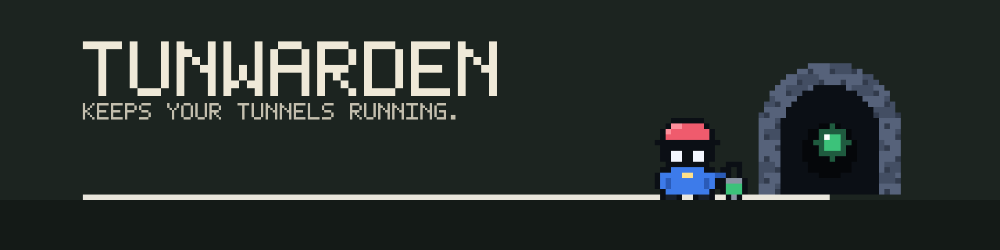

# Tunwarden



Tunwarden keeps your tunnels running. It starts SSH forwards and any command that opens a local port (`gcloud compute start-iap-tunnel`, `kubectl port-forward`, `aws ssm start-session`, ...), checks that each one is really listening, reconnects dropped ones, keeps a log per tunnel, and tells you when a login has expired. One `tunwarden login` renews it and brings the affected tunnels back.

It runs on macOS, Linux and Windows. A small background daemon owns the tunnels, so they survive closing the terminal. There is no account, telemetry or network access of its own.

> Status: early. The CLI and daemon work; the desktop app and sleep/wake handling are next.

## Install

| Platform | Command |
| --- | --- |
| macOS, Linux | `curl --proto '=https' --tlsv1.2 -LsSf https://github.com/Om-jannu/tunwarden/releases/latest/download/tunwarden-cli-installer.sh \| sh` |
| Windows | `powershell -c "irm https://github.com/Om-jannu/tunwarden/releases/latest/download/tunwarden-cli-installer.ps1 \| iex"` |
| From source | `cargo install --git https://github.com/Om-jannu/tunwarden tunwarden-cli` |

Archives for every platform are on the [releases page](https://github.com/Om-jannu/tunwarden/releases). On macOS, prefer the install command: archives downloaded in a browser are quarantined, and Gatekeeper blocks unsigned binaries.

Tunwarden runs your own tools. Install ssh, gcloud, kubectl or whatever your tunnels use.

**Desktop app:** installers for macOS (`.dmg`), Windows (`.msi`, `.exe`) and Linux (`.deb`, `.rpm`, AppImage) are on the releases page once published. The app includes the CLI. It is not signed yet: on macOS open it once with right-click → Open, on Windows choose More info → Run anyway. To build it yourself: `pnpm install`, then `pnpm desktop:build`.

## Quick start

```sh
tunwarden init                    # writes an example config; `tunwarden config-path` shows where
tunwarden import ~/.zshrc         # or turn your existing tunnel aliases into entries (add --write)
tunwarden doctor                  # checks tools, logins and ports
tunwarden start --group daily
tunwarden status
tunwarden logs staging-db -f
tunwarden autostart enable       # start the daemon at login; running tunnels come back after a reboot
```

## Config

```toml
version = 1

[[logins]]                        # something you renew now and then
name = "google"
check = "gcloud config config-helper --force-auth-refresh --format=none"
login = "gcloud auth login me@example.com"
expired = ["Reauthentication failed"]
env = { CLOUDSDK_CORE_ACCOUNT = "me@example.com" }

[[profiles]]                      # environment, production flag and login shared by tunnels
name = "staging"
login = "google"
env = { CLOUDSDK_CORE_PROJECT = "example-staging-123" }

[[tunnels]]                       # any command that opens a local port
name = "staging-db"
profile = "staging"
command = "gcloud compute start-iap-tunnel db-1 5432 --zone=europe-west1-b --local-host-port=127.0.0.1:5433"
groups = ["daily"]
forwards = [{ local_port = 5433 }]

[[tunnels]]                       # SSH forwards are built for you, with keepalives and no prompts
name = "bastion-redis"
type = "ssh-local"
host = "bastion"
jump = ["jump.example.com"]
forwards = [{ local_port = 6380, remote_host = "redis.internal", remote_port = 6379 }]
```

The full example, with AWS and kubectl entries, is [`crates/tunwarden-cli/example-config.toml`](crates/tunwarden-cli/example-config.toml). Commands are never run through a shell: pipes, `&&` and `$VAR` are rejected; point the command at a script if you need them. Quotes group words as in a shell. On Windows a backslash is an ordinary character, so `C:\tools\gcloud.cmd` needs no quotes; on macOS and Linux it escapes the next character, as in a shell.

When a login expires, its tunnels stop with "login expired" and the next step:

```console
$ tunwarden login google
Running the google login (used by staging, prod): gcloud auth login me@example.com
...
logged in; restarting prod-api, staging-db
```

## Commands

`init`, `import`, `list`, `status`, `start`, `stop`, `restart`, `logs`, `show-command`, `add`, `edit`, `remove`, `auth`, `login`, `trust`, `doctor`, `daemon`, `autostart`, `config-path`, `completions`. Run `tunwarden <command> --help` for details and examples. `start` and `stop` take names, `--group`, `--profile` or `--all`.

On a terminal, a command missing its tunnel or login name shows a list to pick from (`tunwarden start`, `tunwarden logs`, `tunwarden login`), `tunwarden add` asks for each field, and `start` shows a live line per tunnel. In scripts and pipes nothing asks or animates, colours are off, and a missing name is an error listing the choices. `NO_COLOR=1` turns colours off everywhere.

Shell completion knows your tunnel, group, profile and login names:

```sh
echo 'source <(tunwarden completions zsh)' >> ~/.zshrc    # or bash; fish and PowerShell in `tunwarden completions --help`
```

## Known limits

- A tunnel counts as healthy while its local port is listening. If the remote side dies but the port stays open, it can show `running` until the tool itself exits; SSH tunnels exit within 45 seconds through keepalives.
- For `ssh-remote`, the server may bind the remote port on IPv6 only when IPv4 is taken, and Tunwarden cannot see that.

## License

MIT OR Apache-2.0, at your option.
